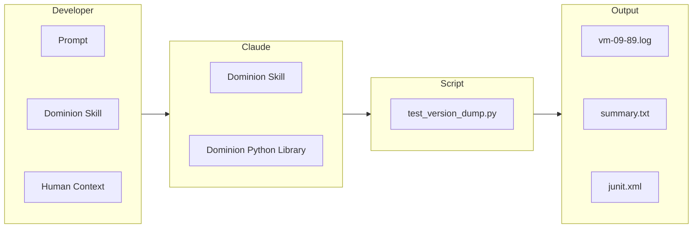
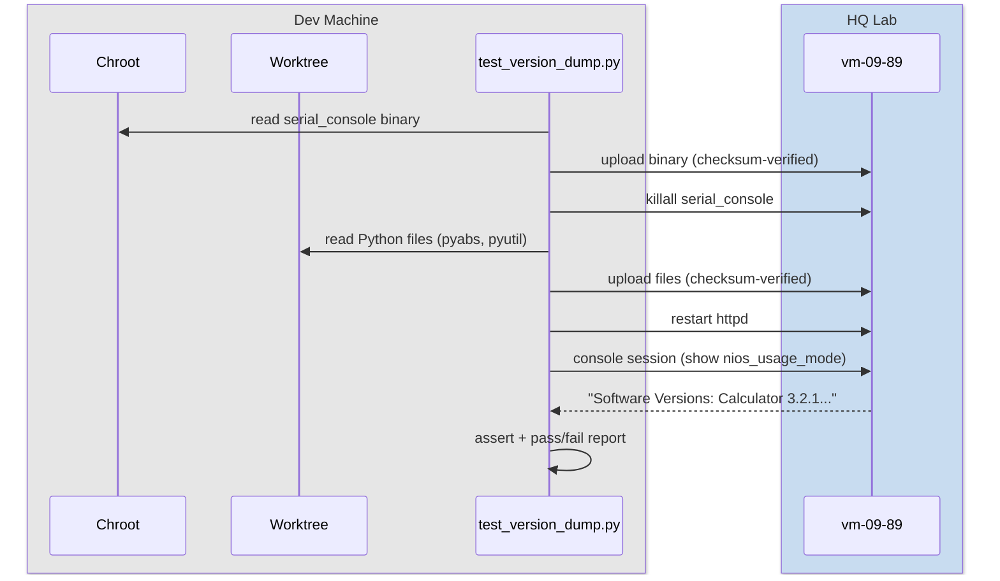

# dominion

dominion provides users complete programmatic control over NIOS.

Using dominion, you (and/or an LLM) can deploy code from worktrees and chroots, open shell and console sessions, make WAPI calls, design and run tests, etc.

[`.claude/skills/dominion/SKILL.md`](.claude/skills/dominion/SKILL.md)  helps Claude turn a users prompt into a deterministic python script that lives forever.

It is also a context engine. Every command dominion runs against NIOS appliances and containers is logged with full output. The more you use it, the more context accumulates.

## How to use dominion: Sample Problem

Devs and QA were running into IPc enablement errors related to the calculator. It turned out that every time the calculator container version changes, a new bundle is required. But there was no way to check which calculator version was running without SSHing in and manually inspecting files.

We wanted to display the calculator version in `show nios_usage_mode`.

### Step 1: Gathering Context

You should consider the state of your dev infrastructure before prompting Claude using `/dominion`. Then decide what you'd like Claude to do depending on

1) The **current state of your dev infrastrucutre** (worktrees, chroots, appliances)
2) Your confidence in Claudes ability to produce good output **given the prompt and context you've provided it**

Below is a visual representation of the flow from prompt to output:



In this example, I've gathered context on my dev infrastructure:

1. **Chroot**: I've already ran `make install` into `/local/91/chroots/balerion`, so the compiled `serial_console` binary is ready
2. **Worktree**: Python changes (`calculator_common.py`, `token_constants.py`) are applied in our worktree
3. **Appliance**: `vm-09-89` is up, SSH-reachable, and we can reach both the root shell and the Infoblox console

Because of the state of my infrastrucuter, I should ask dominion to:

1. Deploy the built `serial_console` binary from the **chroot**
2. Deploy Python changes that fetch the calculator version from my **worktree**
3. Verify that `show nios_usage_mode` now displays the "Software Versions" section on the **appliance**



### Step 2: Craft a prompt

With that context, we can craft a prompt:

```
Use /dominion to create a script given the problem statement:

Devs and QA were running into IPc enablement errors related to the calculator. It turned out that every time the calculator container version changes, a new bundle is required. But there was no way to check which calculator version was running without SSHing in and manually inspecting files.

We wanted to display the calculator version in `show nios_usage_mode`.

I've gathered context on my dev infrastructure:

1. **Chroot**: I've already ran `make install` into `/local/91/chroots/balerion`, so the compiled `serial_console` binary is ready
2. **Worktree**: Python changes (`calculator_common.py`, `token_constants.py`) are applied in our worktree
3. **Appliance**: `vm-09-89` is up, SSH-reachable, and we can reach both the root shell and the Infoblox console

Create a script for me to deploy the changes and test results. I will run the script myself.
```

**Note:** Use `/plan` when starting out.

## Step 3: Results

Claude compiles your prompt into deterministic python code using the dominion library. It looks something like this:

```python
from dominion import Appliance, ApplianceConfig, Run

run = Run()
app = Appliance.from_config(ApplianceConfig(
    hostname="vm-09-89",
    ip="10.35.211.9",
    chroot="/local/91/chroots/balerion",
    worktree="/blox/you/NIOSRFE-15716",
    output_dir=run.output_dir,
))

# Phase 0: deploy a C binary and Python files to the appliance
run.test("deploy serial_console binary",
         lambda: app.deploy_serial_console())
run.test("deploy Python changes",
         lambda: app.deploy_token_py(groups={"pyabs", "pyutil"}))

# Phase 1: verify the changes via console session
def check_version_output():
    with app.console_session() as console:
        output = console.run("show nios_usage_mode")
        assert "Software Versions" in output, f"missing section in: {output}"

run.test("console shows Software Versions section", check_version_output)

run.summary(app)
```


### Results

dominion is designed to log every command ran on the appliance. Below is sample output from a run:

```
results/2026-08-25_14-32-07/
  summary.txt          
  junit.xml            
  vm-09-89.log          

============================================================
RESULTS: 3 passed, 0 failed, 0 skipped out of 3
============================================================
  PASS  deploy serial_console binary
  PASS  deploy Python changes
  PASS  console shows Software Versions section
```

`vm-09-89.log` is a transcript of the exact commands run on that appliance. It is no different from you typing the commands yourself.

### Feeding results back

You can inspect the results yourself, or loop them back into Claude. The output directory is context that Claude can read, reason about, and act on.

Use the `/goal` command in your prompt to create a self-verification loop. Claude runs the script, reads the results, and decides what to do next.

