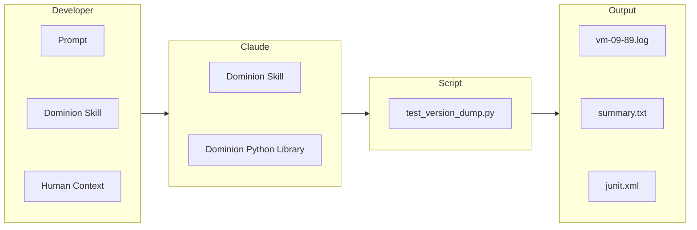
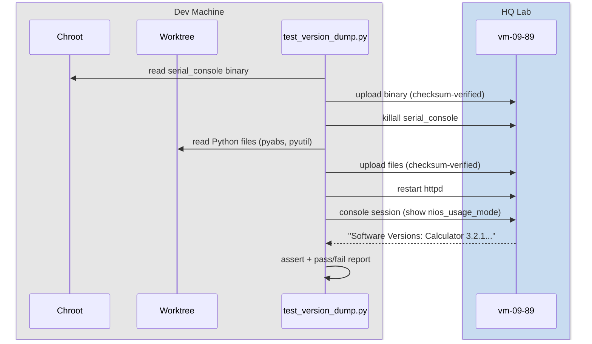

# dominion

dominion provides users complete programmatic control over NIOS.

Using dominion, you (and/or an LLM) can deploy code from worktrees and chroots, open shell and console sessions, make WAPI calls, design and run tests, etc.

[`.claude/skills/dominion/SKILL.md`](.claude/skills/dominion/SKILL.md)  helps Claude turn a users prompt into a deterministic python script that lives forever.

It is also a context engine. Every command dominion runs against NIOS appliances and containers is logged with full output. The more you use it, the more context accumulates.

## How to use dominion: Sample Problem

Devs and QA were running into IPc enablement errors related to the calculator. It turned out that every time the calculator container version changes, a new bundle is required. But there was no way to check which calculator version was running without SSHing in and manually inspecting files.

We wanted to display the calculator version in `show nios_usage_mode`.

### Step 1: Gathering Context

You should consider the state of your dev infrastructure before prompting Claude using `/dominion`. Then decide what you'd like Claude to do depending on

1) The **current state of your dev infrastrucutre** (worktrees, chroots, appliances)
2) Your confidence in Claudes ability to produce good output **given the prompt and context you've provided it**

Below is a visual representation of the flow from prompt to output:



In this example, I've gathered context on my dev infrastructure:

1. **Chroot**: I've already ran `make install` into `/local/91/chroots/balerion`, so the compiled `serial_console` binary is ready
2. **Worktree**: Python changes (`calculator_common.py`, `token_constants.py`) are applied in our worktree
3. **Appliance**: `vm-09-89` is up, SSH-reachable, and we can reach both the root shell and the Infoblox console

Because of the state of my infrastrucuter, I should ask dominion to:

1. Deploy the built `serial_console` binary from the **chroot**
2. Deploy Python changes that fetch the calculator version from my **worktree**
3. Verify that `show nios_usage_mode` now displays the "Software Versions" section on the **appliance**



### Step 2: Craft a prompt

With that context, we can craft a prompt:

```
Use /dominion to create a script given the problem statement:

Devs and QA were running into IPc enablement errors related to the calculator. It turned out that every time the calculator container version changes, a new bundle is required. But there was no way to check which calculator version was running without SSHing in and manually inspecting files.

We wanted to display the calculator version in `show nios_usage_mode`.

I've gathered context on my dev infrastructure:

1. **Chroot**: I've already ran `make install` into `/local/91/chroots/balerion`, so the compiled `serial_console` binary is ready
2. **Worktree**: Python changes (`calculator_common.py`, `token_constants.py`) are applied in our worktree
3. **Appliance**: `vm-09-89` is up, SSH-reachable, and we can reach both the root shell and the Infoblox console

Create a script for me to deploy the changes and test results. I will run the script myself.
```

**Note:** Use `/plan` when starting out.

## Step 3: Results

Claude compiles your prompt into deterministic python code using the dominion library. It looks something like this:

```python
from dominion import Appliance, ApplianceConfig, Run

run = Run()
app = Appliance.from_config(ApplianceConfig(
    hostname="vm-09-89",
    ip="10.35.211.9",
    chroot="/local/91/chroots/balerion",
    worktree="/blox/you/NIOSRFE-15716",
    output_dir=run.output_dir,
))

# Phase 0: deploy a C binary and Python files to the appliance
run.test("deploy serial_console binary",
         lambda: app.deploy_serial_console())
run.test("deploy Python changes",
         lambda: app.deploy_token_py(groups={"pyabs", "pyutil"}))

# Phase 1: verify the changes via console session
def check_version_output():
    with app.console_session() as console:
        output = console.run("show nios_usage_mode")
        assert "Software Versions" in output, f"missing section in: {output}"

run.test("console shows Software Versions section", check_version_output)

run.summary(app)
```


### Ticket tests

Ticket tests use `Ticket` instead of wiring `Run` by hand. It tees stdout/stderr/logs into `run.log`, connects, gates phases on prerequisites, always runs cleanups, and writes `report.md` (per phase: preconditions, every WAPI call and `container.sh()` call with full responses, checks with expected vs got, errors), `summary.txt` and `junit.xml`. Leaving the block exits 1 on any failure or any phase skipped for an unmet `pre` precondition, else 0.

```python
from dominion import Ticket

t = Ticket("NIOS-111642", HOST, results_dir=RESULTS_DIR, worktree=WORKTREE, wapi_version="v2.15")
with t:
    t.cleanup(lambda: final_cleanup(t))
    connect = t.phase("1. connect", t.connect)
    dep = t.phase("1b. deploy", lambda: deploy(t), needs=connect,
                  skip=None if args.deploy else "no --deploy")
    pre = t.phase("2. preflight", lambda: preflight(t), needs=[connect, dep])
    t.phase("6. member latch", lambda: member_latch(t), needs=pre,
            pre=[("archive backed up", lambda: t.container.sh(f"test -f {BACKUP}", check=False)[0] == 0)])

def member_latch(t):
    rows = t.app.wapi.get("ipc:overage", params="_return_fields=upsize_status")
    with t.checks("member latch") as c:
        c.expect("upsize_status", "OVERAGE_UPSIZE", rows[0]["upsize_status"])
```

For a multi-step flow over a box with observable state, `t.steps` runs `(name, from_state, to_state, fn)` steps in order. Each step gates only on its own `probe()` (a failed step does not block a later step whose from-state the box is in), asserts the probed state after `fn`, and shows `State: A -> B (probed before: A, after: B)` in `report.md`. A step whose from-state is not met is skipped and exits 1, like an unmet `pre`. `home=(name, state, fn)` runs last, after cleanups, and must leave the box in `state`. `needs=` works as in `phase`. Probe calls are not listed under Calls.

```python
t.steps(
    [("5. build", "Licenses", "IPc", lambda: build(t)),
     ("6. latch", "IPc", "IPc", lambda: latch(t))],
    probe=lambda: box_state(t), needs=connect,
    home=("home", "Licenses", lambda: reset(t)),
)
```

A phase is skipped (and its dependants with it) when a `needs` phase failed or was skipped, or a `pre` precondition is unmet. A `skip=` reason is a deliberate skip: it does not block dependants or change the exit code. An unmet `pre` shows as SKIP but exits 1. `Ticket(..., state={...})` gives `t.state`, a namespace for values shared between phases; its fields are listed in `report.md` under "State at exit". Use `t.container.sh(cmd)` for shell commands in the NIOS container. Request bodies, sh commands and responses are recorded as given, with no masking, so keep secrets out of them.

Helpers for ticket tests:

- `with t.nios_log("ipc:bundle ") as nl:` marks infoblox.log, then `nl.lines` holds the lines containing the fixed string written inside the block (set also when the block raises). The grep is listed under Calls.
- `c.expect_status(label, want, status, body)` checks an HTTP status and shows the body start in the label.
- `c.oplog_summary / oplog_count / oplog_step / oplog_event / oplog_contract` (`oplog_contract(..., labels={"caller": "criterion 7"})` prefixes check labels; kinds caller, rid, secret, tb) check NIOS `oplog` request lines (`src/oplog.py`, `oplog.parse(lines, tag)`). The line format comes from a NIOS change that is not merged yet and may change.
- `app.usage_mode()` returns `"Licenses"` or `"IPc"`. `container.upload_file(src, dest)` uploads, cleans stale `.pyc`/`.pys` and verifies the md5 (`DeployError` with both hashes). `app.wapi.request(..., timeout=)` overrides the transport timeout for one call. `patched_bundle` and `upload_bundle_token(app, path)` (in `dominion.actions`) patch the token bundle with the grid's `lpc_uid` and upload it with fileop. `enable_token_mode_wapi` also returns the upload `"token"`. `BUNDLE_OBJECT` (`"ipc:bundle"`) is exported from `dominion.actions`.
- `container.dump_log` and `count_log` appear under Calls like `sh`. `dump_log(..., fixed=True)` greps a fixed string.

#### TicketTest

`TicketTest` (`src/ticket_test.py`) turns a ticket test into a class: dominion runs `Ticket` and `t.steps`, the ticket supplies the steps. `run()` does phases `1. connect`, `2. deploy` (`deploy_files` md5-checked, then `deploy_groups`, then WAPI ready; skipped when `skip_deploy` or nothing to deploy), `3. preflight` (default: `probe() == home_state`), then each `@step(src, dst, title)` method as `4. <title>`, `5. <title>`, ..., then `home` unless `skip_home`. Steps run in class definition order, inherited steps first; a subclass that redefines a step name keeps the inherited position. Step return values are ignored. Use `self.app`, `self.container`, `self.state`, `self.checks(...)` and `self.nios_log(...)`. `run()` exits the process like `Ticket`. Gates (`skip_deploy`, `skip_home`) are constructor arguments: dominion reads no env vars.

```python
from dominion.actions import IPC, LICENSES, IpcTicketTest
from dominion import step

class Oplog(IpcTicketTest):
    name = "NIOS-111696-oplog"
    bundle_path = BUNDLE
    deploy_files = {"products/one/server/src/pyutil/oplog.py": OPLOG_DEST}

    @step(LICENSES, LICENSES, "apply rejected in Licenses mode")
    def apply_rejected(self):
        with self.nios_log("ipc:bundle ") as nl:
            status, body = self.bundle("apply", {"token": self.upload_bundle_token()})
        with self.checks("apply rejected") as c:
            c.expect_status("apply", 400, status, body)
            c.oplog_summary(nl.lines, fn="apply", outcome="rejected", code_suffix="NOT_ENABLED")

Oplog(HOST, worktree=WORKTREE, results_dir=RESULTS_DIR, skip_deploy=SKIP_DEPLOY).run()
```

Subclass `TicketTest` directly for other boxes: define `name`, `home_state`, `probe()` and `home()`. `IpcTicketTest` (`actions/ipc_ticket.py`) supplies them for IPc: state from `app.usage_mode()`, home with `reset_all`, `deploy_groups={"pyabs"}`, WAPI v2.15. `upload_bundle_token(bundle=None)` uploads the patched bundle (default `bundle_path`) and keeps the token in `self.state.tokens`. `bundle(func, data, timeout=None)` POSTs `ipc:bundle?_function=func` and returns `(status, body)` without raising; `apply` gets a 300s timeout. `initial_state` seeds `self.state` (`IpcTicketTest` uses `{"tokens": []}`). `deploy_required` lists worktree subpaths (relative to `worktree`) that must be files: the deploy phase fails if one is not a file after deploying, or was skipped by `deploy_token_py`; the `deploy_token_py` result is kept in `self.deploy_result`. `bundle_path` is the default bundle for `upload_bundle_token()` and `enable_ipc()` (the action `enable_token_mode_wapi`; it returns the action's result and keeps the upload token in `self.state.tokens`). `deploy_title`, `preflight_title` and `home_title` rename the phases (`2. <deploy_title>`, `3. <preflight_title>`, unnumbered home). Override `preflight()` (and call `super().preflight()`) or `deploy()` for ticket-specific setup.

Every `Ticket` run also writes `report.html` next to `report.md`: a self-contained page (inline CSS, no JS, light and dark) with a PASS/FAIL header and one card per phase, step, cleanup and home. Cards show the status, state line, skip reason, checks (failures first), error, the `nios_log` captures (oplog lines with fn/step/event, rid, dur and outcome highlighted) and the calls in a collapsed `<details>`. It is built from the same data as `report.md` (`src/report_html.py`); a render error is a warning and does not affect the run. `report.md` and `report.html` show at most the last 200 lines of each `nios_log` capture (and of a `dump_log` call); the full text is in the capture file `nios_log/N.log` under the results directory.

A run that used `nios_log` also writes `nios_log.log`: every captured NIOS line, grouped by phase or step in run order. Each group starts with `== <name> | <from -> to> | <PASS|FAIL|SKIP> <duration> | N lines`, and its lines are sorted by the infoblox.log timestamp (a line without one keeps its place). It is built from the captures, with no cap and no re-read of infoblox.log. The summary prints it after the results (first 100 lines, then `... N more file lines, see <path>`), `summary.txt` has a `NIOS log: <path> (N lines)` line, and `report.html` links to it. Without any capture, none of that appears.

### NIOS unit tests (run_py_tests)

`container.run_py_tests(tests, keywords="all", timeout=PY_TESTS_TIMEOUT)` runs `/infoblox/tests/bin/run_py_tests --no-check-licenses -k <keywords> -v -N <test> <test> ... 2>&1` (`-N` is the boolean --dontfork flag, given once; the tests are positional, a name or a list; `keywords="all"` runs every test of them, ibtest's default is `quick`), after waiting for admin-httpd and WAPI (`wait=False` skips). It returns a `PyTestResult`: `ran` (the "Ran N tests" sum), `tests` (`PyTest(id, status, reason)`), `counts`, `raw`, `rc`, `import_errors`, `verdict` and `ok` (rc 0, `ran` > 0, only ok/skipped/expected failure, no import error, as many parsed tests as `ran`), `log_path`. The exit code alone is not trusted: a bad class name exits 0 with an import error. Never run two at once on one container (each run factory-resets the box): a second call raises while a `run_py_tests` process is running. `report.md` keeps the last 200 lines of the output; the full text is in `result.raw` and, in a Ticket (or with `output_dir=`), in `py_tests/<n>.log` (`result.log_path`). The busy error names the running process.

`container.deploy_test_files([worktree subpaths])` uploads NIOS test files (e.g. `products/one/server/src/wapi/test/test_token_bundle.py`) to `/infoblox/tests/lib/python/infoblox/test/<PY_TEST_SUBDIR>/`, md5-verified, where the subdir comes from the test directory's Makefile (`one` if unset; only a plain `PY_TEST_SUBDIR =` line is read). `Ticket.connect_local("drogon")` targets an NCC container (a `LocalAppliance`, calls land in `report.md`), and `c.py_tests(result)` records one check per test.

```python
with Ticket("NIOS-111696-ncc", None, results_dir=DIR, worktree=WORKTREE) as t:
    connect = t.phase("1. connect", lambda: t.connect_local("drogon"))

    def run():
        t.container.deploy_test_files([WAPI_TEST, PYUTIL_TEST])
        result = t.container.run_py_tests(
            ["infoblox.test.one.test_oplog"], keywords="base")
        with t.checks("test_oplog") as c:
            c.py_tests(result)

    t.phase("2. unit tests", run, needs=connect)
```

### Coverage of the changed lines

`coverage_on(app, include=[...])` (in `dominion.actions`) installs a coverage hook in the container (a `.pth` in `/usr/lib/python3/dist-packages`, a daemon thread saves every 2 s because admin-httpd workers never run atexit) and restarts admin-httpd. `coverage_off(app, out_dir, worktree=, base=)` combines the data, copies `coverage.json` to `out_dir`, moves the `.pth` away, restarts admin-httpd, then intersects the lines changed in `git diff -U0 base..HEAD` with the measured ones and writes `coverage.txt` (per changed file `changed lines run X/Y`, the lines that did not run, files that were not measured) and `changed_lines.json`. Container files map by directory and basename (pyabs, pyutil, wapi, ibap). Every Python process on the box loads the hook during the session (`include` limits what is measured), and on an appliance the ticket test must use `skip_home`: `reset_all` removes the hook.

### Results

dominion is designed to log every command ran on the appliance. Below is sample output from a run:

```
results/2026-08-25_14-32-07/
  summary.txt          
  junit.xml            
  vm-09-89.log          

============================================================
RESULTS: 3 passed, 0 failed, 0 skipped out of 3
============================================================
  PASS  deploy serial_console binary
  PASS  deploy Python changes
  PASS  console shows Software Versions section
```

`vm-09-89.log` is a transcript of the exact commands run on that appliance. It is no different from you typing the commands yourself.

### Feeding results back

You can inspect the results yourself, or loop them back into Claude. The output directory is context that Claude can read, reason about, and act on.

Use the `/goal` command in your prompt to create a self-verification loop. Claude runs the script, reads the results, and decides what to do next.

